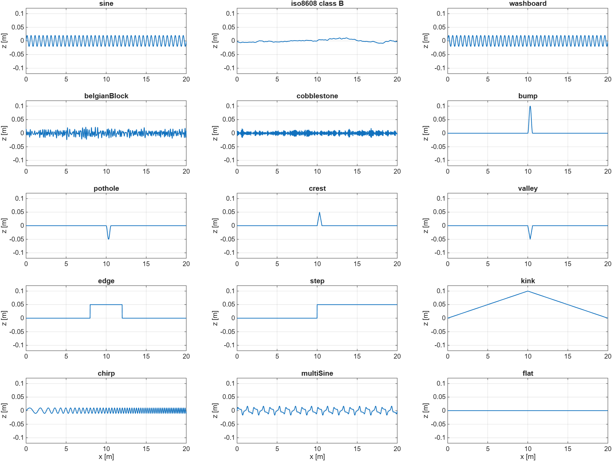
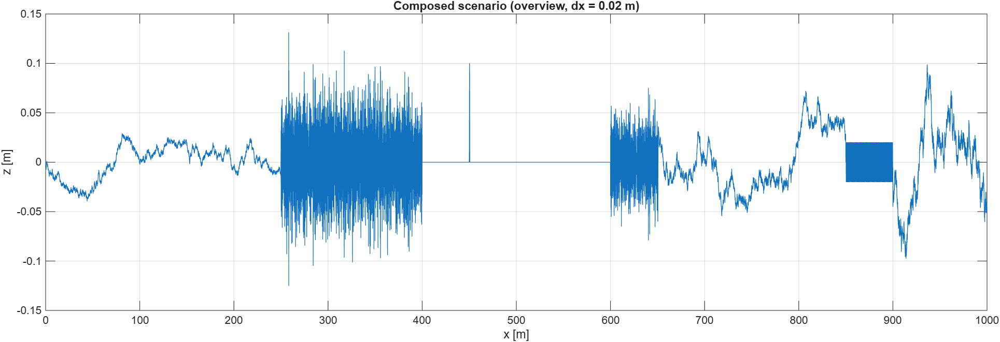
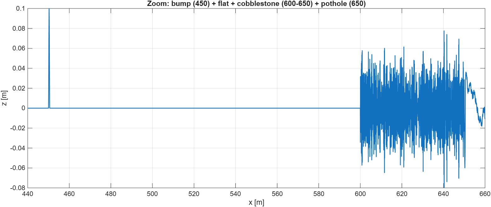
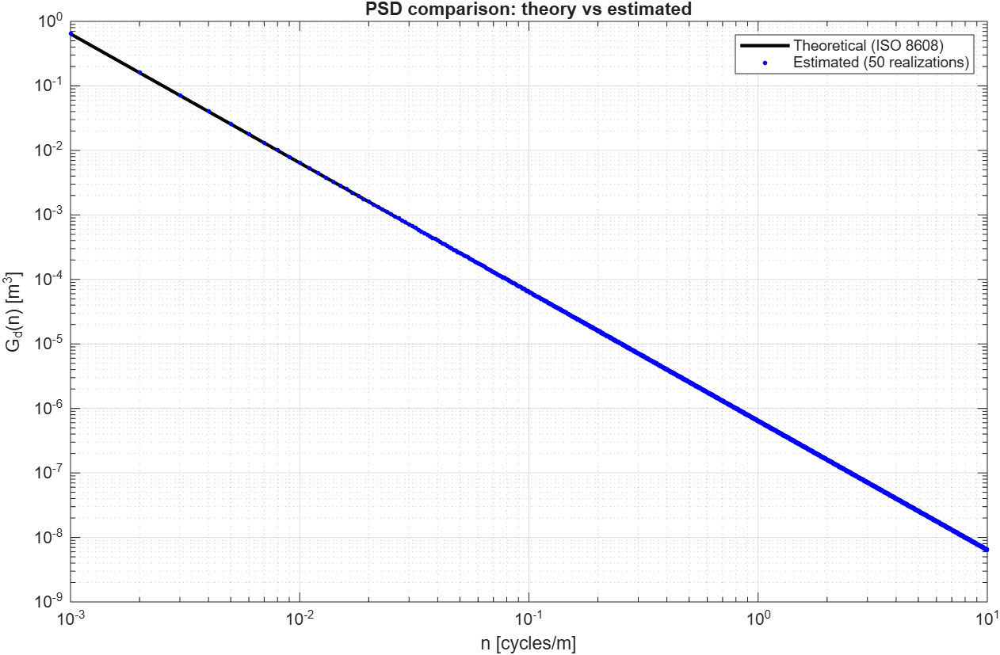
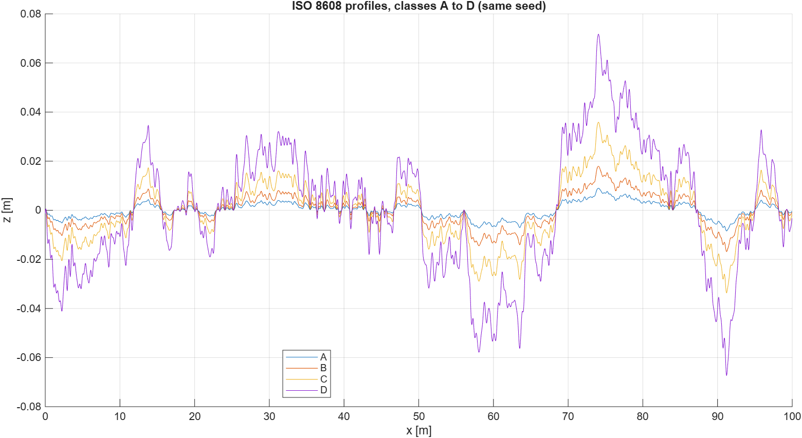

# vd-road-scenarios

[](https://github.com/RobCut/vd-road-scenarios/actions/workflows/test.yml)

A MATLAB toolbox for generating synthetic road profiles: ISO 8608 roughness, proving-ground surfaces, deterministic events, and a composer for multi-zone scenarios.

## Problem

Vehicle dynamics and durability simulations need road inputs. ISO 8608 defines a spectral model for stochastic roughness, but real proving grounds also contain deterministic events (bumps, potholes, steps) and narrow-band surfaces (Belgian block, cobblestone, washboard). Re-implementing each of these patterns from scratch, in a consistent way, is time-consuming and error-prone.

`vd-road-scenarios` provides a unified catalog and a composer that assembles them into a single spatial profile.

## What it does

- `roadprofile.iso8608PSD`, `roadprofile.iso8608Profile`: ISO 8608 classes A–H, mean-zero stochastic roughness.
- `roadprofile.sine`, `roadprofile.washboard`, `roadprofile.chirp`, `roadprofile.multiSine`: deterministic periodic and sweep patterns.
- `roadprofile.belgianBlock`, `roadprofile.cobblestone`: narrow-band stochastic proving-ground surfaces.
- `roadprofile.bump`, `roadprofile.pothole`, `roadprofile.crest`, `roadprofile.valley`, `roadprofile.edge`, `roadprofile.step`, `roadprofile.kink`, `roadprofile.flat`: events, discontinuities, and constant surfaces.
- `roadprofile.compose`: assemble segments into a multi-zone scenario, with deterministic seed derivation for the stochastic patterns.

## Quick start

```matlab
segs = [struct('Start', 0,   'Stop', 100,   'Type', "iso8608", 'Params', {{'B'}})
        struct('Start', 100, 'Stop', 100.6, 'Type', "bump",    'Params', {{0.05, 0.6, 0}})];
p = roadprofile.compose(120, 0.01, segs, Seed=42);
plot(p.x, p.z)
```

## Results



*The complete catalog of 15 patterns on a common spatial grid.*



*A 1000 m mixed scenario built with `compose`: ISO B, Belgian block, bump, cobblestone, pothole, ISO C, washboard, ISO D.*



*Bump and pothole. The step at 650.6 m is a segment boundary: `compose` does not blend transitions.*



*Welch estimate (99 segments, class B) against ISO 8608: mean ratio 1.00, range 0.91–1.09 between 0.03 and 2.5 cycles/m.*



*Classes A to D with the same seed.*

## Method

Each pattern returns a struct with fields `x`, `z`, `dx` (column vectors, `x` starting at 0). Patterns accept `(L, dx, ...)` as the first two positional arguments and follow common conventions (spatial frequency in cycles/m for sinusoidal patterns, wavelength in m for paving patterns, Nyquist checks, a Seed name-value for stochastic patterns).

`compose` snaps segment boundaries to the nearest sample, sums overlapping contributions, fills gaps with zero, and derives a unique seed for every stochastic segment (recorded in `p.segments(k).SeedUsed`). The design decisions are documented in `docs/DESIGN.md`.

## Limitations

- 1D only: `z(x)`, no 3D surfaces or lateral variation (2D road patches are deferred).
- No vehicle model: this toolbox produces road profiles, not vehicle responses. Simulation is out of scope.
- `compose` does not smooth transitions: if a stochastic segment ends at a non-zero elevation and the next starts at zero, the profile has a step. This is a deliberate choice, documented in DESIGN §13.
- No import from CRG/CSV yet (planned).
- ISO 8608 synthesis is limited to 0.011–2.83 cycles/m by default.
- Paving surfaces are illustrative models, not validated against measurements.

## Reproducibility

Requirements:

- MATLAB R2026b Update 1 (verified). Newer versions should work.
- No additional toolboxes.

To reproduce:

1. Open `vd-road-scenarios.prj` in MATLAB. The project adds `src/` and `tests/` to the path.
2. Run the test suite: `buildtool test`
3. Regenerate the figures by running the four scripts in `examples/`.


## Documentation

- `docs/DESIGN.md` — design decisions, pattern conventions, seed handling.

## License

MIT. See `LICENSE`.
